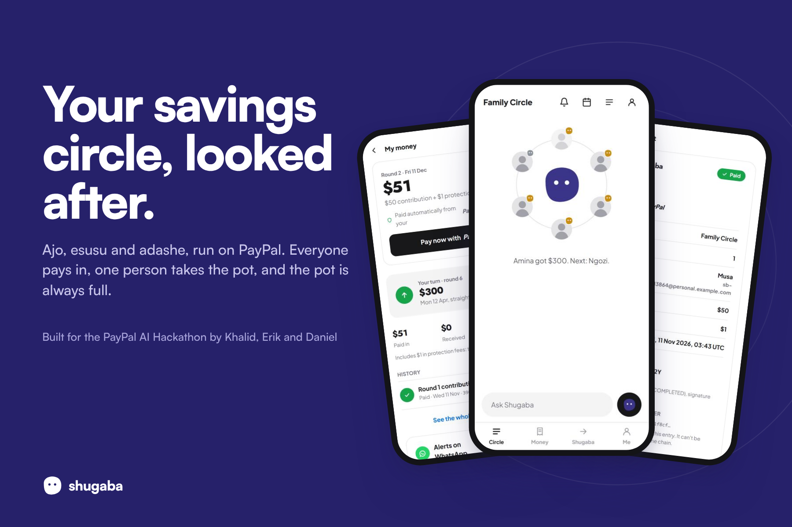
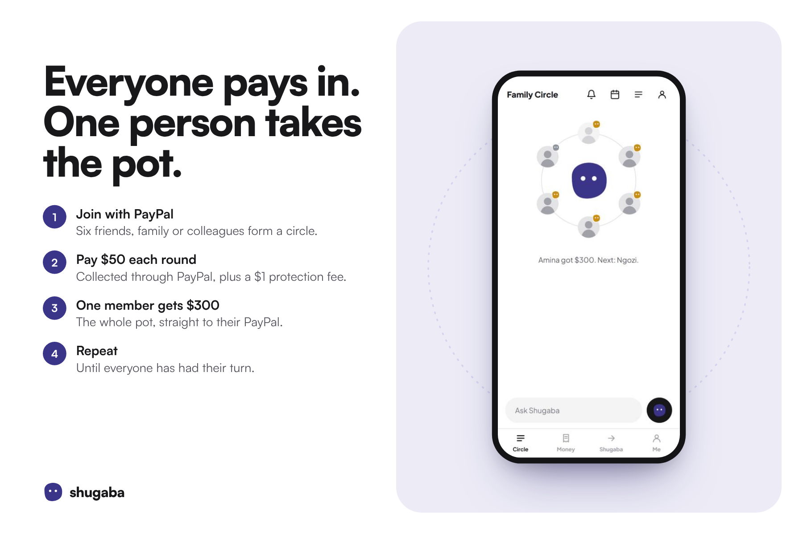
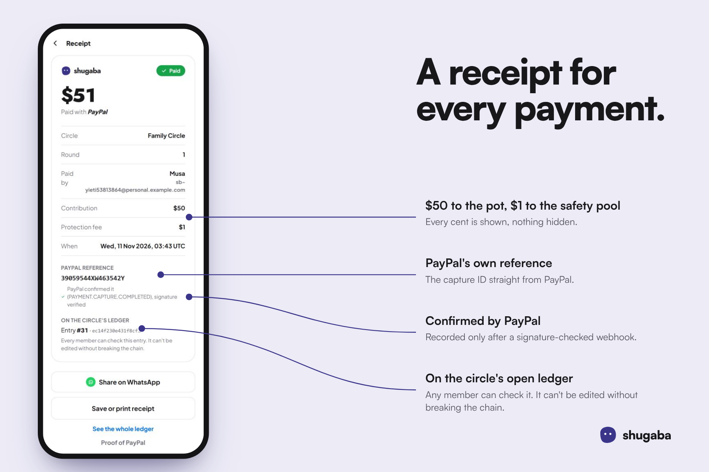
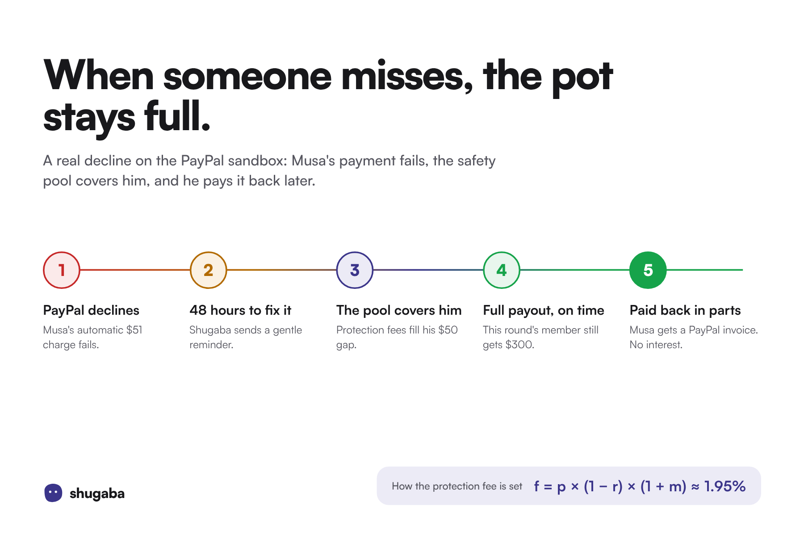
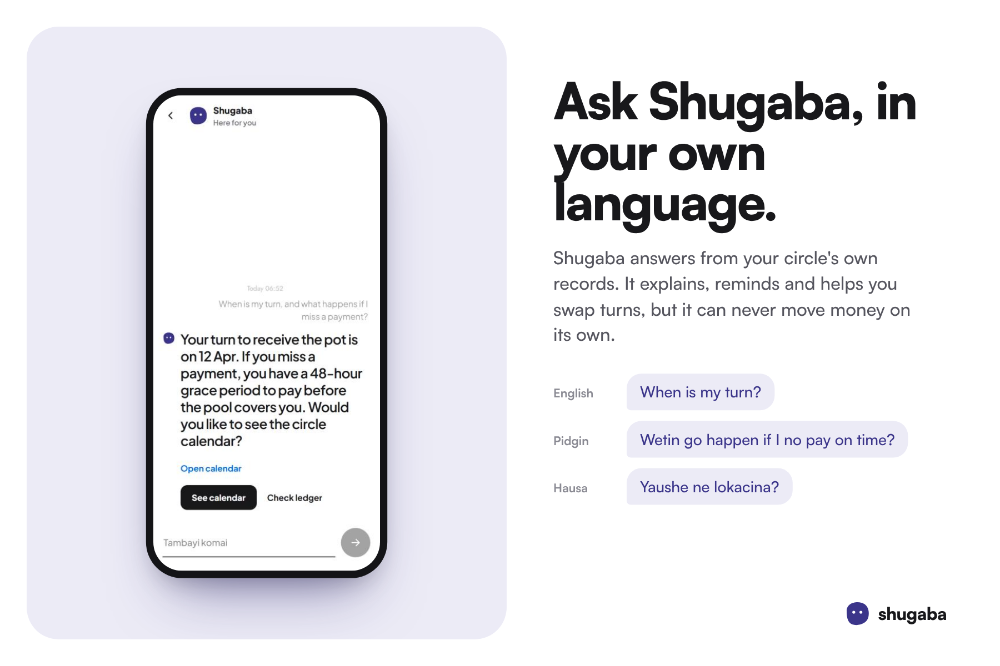
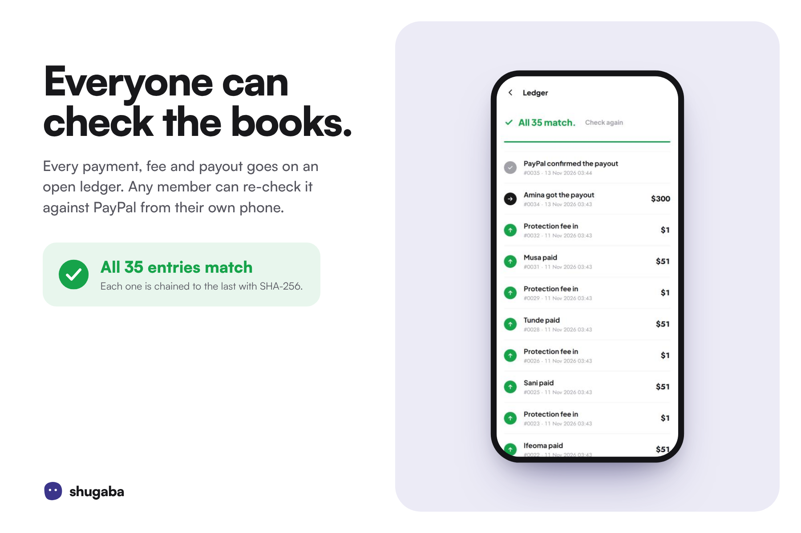
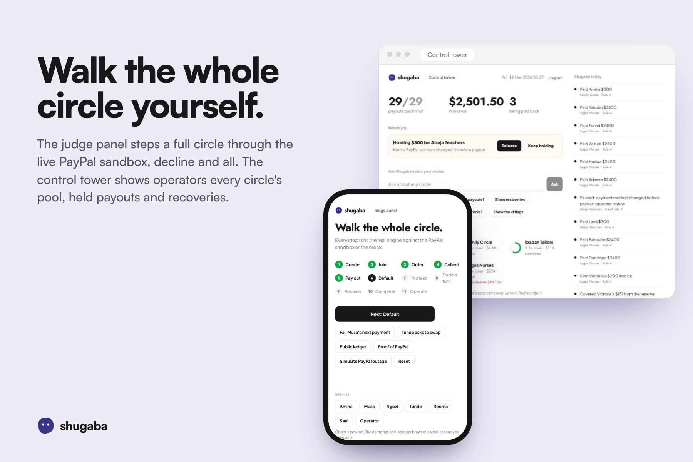

# shugaba

**Your savings circle, looked after.** Shugaba runs a rotating savings circle (adashe, esusu, ajo) on PayPal. Everyone pays in each round, one person collects the whole pot, and a small protection fee makes sure that person is paid in full even when someone misses a payment. Shugaba, a calm stone who lives in the app, explains the rules in English, Pidgin and Hausa, chases late payments kindly, and helps members swap turns.

Built for the PayPal AI hackathon.

- **Live demo:** https://shugaba-demo-cve8.onrender.com (judge panel at [`/judge`](https://shugaba-demo-cve8.onrender.com/judge))
- **Built with:** PayPal sandbox (Log in with PayPal, Vault v3, Orders v2, Payouts v1, Invoicing v2, Webhooks), Google Gemini, Next.js, PostgreSQL and Render, written with Claude Code as our pair programmer.



---

## Try it in 2 minutes

1. Open the live demo and go to **`/judge`**.
2. Press **Next** to walk the circle: create, join, order, collect, pay out, a missed payment, cover, a swap, recovery and completion. Every step runs the real engine.
3. Under **See it as**, open the app as Amina, Musa, Ngozi, Tunde, Ifeoma or Sani, or as the operator (control tower at `/ops`).
4. Press **Reset** to start again.

Demo logins are on `/login`. They only exist in demo mode, and the app refuses to boot in demo mode on any host outside `DEMO_ALLOWED_HOSTS` or against live PayPal.

## The problem

Rotating savings circles are one of the most common ways people save across West Africa and its diaspora. In Nigeria alone, 39% of adults (about 40 million people) used informal financial services in 2023, and 11.7 million saved or borrowed through a savings group ([EFInA, Access to Financial Services in Nigeria 2023](https://a2f.ng/wp-content/uploads/2024/07/A2F-2023-SURVEY-REPORT-1.pdf)). They run on trust and WhatsApp groups. When one person misses a payment, the person due to collect is short, and arguments start. Members abroad (Houston, London) and at home (Kano, Lagos, Abuja) cannot easily pay into the same circle.

Shugaba keeps the circle's familiar shape and fixes three things: the recipient always gets the full pot, every payment is on a public ledger anyone can verify, and money moves through PayPal across borders.

## Five pillars

| Pillar | What it does | Where |
|---|---|---|
| Full pot, every time | Risk-priced protection fee (1–3%) funds a circle pool and a global reserve that cover a missed payment. The defaulter gets a gentle repayment plan. | `src/lib/treasury`, `src/lib/engine/rounds.ts` |
| Open ledger | Every state change is a hash-chained ledger event. Anyone can verify the chain in the browser at `/verify/[id]` (initials only). | `src/lib/db/ledger.ts`, `src/components/verify-chain.tsx` |
| Shugaba | A chat companion in English, Pidgin and Hausa. Answers from the member's own ledger facts, cites the rule, offers to split a payment, and refuses to move money anywhere else. | `src/lib/agents/shugaba.ts` |
| Turn swaps | Drag your turn on the payout calendar. Member agents negotiate a swap within each member's preferences; both members sign. A bonus is held in the pool until the later payout. | `src/lib/engine/market.ts`, `src/components/payout-calendar` |
| Circle Score | Paying on time earns trust levels (Newcomer, Steady, Trusted, Pillar), awarded by Shugaba. Scores set the payout order and the protection tier. | `src/lib/score`, `src/lib/engine/score.ts` |

| | |
|---|---|
|  |  |
|  |  |
|  |  |

More in [`docs/devpost-gallery`](docs/devpost-gallery).

## How money moves

```
member PayPal ──(Orders v2 capture / vaulted payment)──▶ platform account
                                                          │
                     protection fee ──▶ circle pool (75%) + global reserve (25%)
                                                          │
platform account ──(Payouts v1)──▶ this round's recipient: full pot
                                                          │
missed payment ──▶ pool covers ──▶ recovery invoice (Invoicing v2) ──▶ reserve repaid first, then pool
```

- Money is always an integer number of cents. Amounts become decimal strings only inside `src/lib/paypal`.
- Agents only propose. Only the treasury worker moves money, and every state change writes its ledger event first.
- The worker (pg-boss) runs inside the web process, so the whole app fits one free Render service.
- Production would need a licensed custody partner to hold pooled funds. The demo uses the PayPal sandbox or a built-in mock.

## Proven on the PayPal sandbox

The full Family Circle has been run end to end against the real PayPal sandbox, not only the mock:

- **6 members** saved PayPal for automatic contributions (Vault setup tokens, buyer approval, payment tokens).
- **36 contributions** of $51 charged to the saved PayPal accounts through Orders v2, each with a real capture id.
- **6 payouts** of $300 sent through Payouts v1, each confirmed by a `PAYMENT.PAYOUTS-ITEM.SUCCEEDED` webhook before the round closed.
- **78 webhooks** received, every one signature-checked with `verify-webhook-signature`.
- A payout PayPal refused (`RECEIVER_COUNTRY_NOT_ALLOWED`) was marked failed from its webhook and retried to a corrected account, so a refused payout never leaves a round hanging.

## PayPal integration

Everything runs in the free PayPal sandbox: a sandbox business account is the platform account and sandbox personal accounts are the members.

| Use | API | Endpoint | Code |
|---|---|---|---|
| Sign-in | Log in with PayPal | `/connect`, `POST /v1/oauth2/token` (authorization code), `GET /v1/identity/oauth2/userinfo` | `src/lib/auth/paypal-login.ts` |
| Save PayPal once | Vault v3 | `POST /v3/vault/setup-tokens`, `POST /v3/vault/payment-tokens` | `src/lib/paypal/paypal.ts` |
| Contributions (automatic, or early with one tap) | Orders v2 | `POST /v2/checkout/orders` with the vaulted payment source, `.../capture` | `src/lib/paypal/paypal.ts` |
| Payouts | Payouts v1 | `POST /v1/payments/payouts` | `src/lib/paypal/paypal.ts` |
| Recovery invoices (pay back in parts) | Invoicing v2 | `POST /v2/invoicing/invoices`, `.../send` | `src/lib/paypal/paypal.ts` |
| Reconciliation | Transaction Search | `GET /v1/reporting/transactions` | `src/worker/reconcile.ts` |
| Webhooks | Notifications | `POST /v1/notifications/verify-webhook-signature` | `src/app/api/webhooks/paypal` |

Every capture, payout and invoice is written to the ledger only after a signature-checked webhook confirms it. A payout PayPal refuses is marked failed and can be sent again. A Subscriptions provider (`/v1/billing/plans`, `/v1/billing/subscriptions`) is also wired but not used by default; Vault mode is the default.

`PAYMENT_PROVIDER=mock` swaps in a mock provider that emits webhook-shaped events through the same pipeline, so the app runs with zero keys.

## AI

Shugaba uses **Google Gemini** through the Vercel AI SDK (`ai` and `@ai-sdk/google`): `gemini-3.6-flash` for the agents and `gemini-3.1-flash-lite` for fast, short tasks (set with `LLM_MODEL_AGENT` and `LLM_MODEL_FAST`).

| Agent | Model | Purpose | Guardrail | Code |
|---|---|---|---|---|
| Shugaba (chat) | Gemini 3.6 Flash | Answers questions, explains rules, offers payment plans | Facts come from the ledger; a regex guard blocks payout redirects, rule changes, other members' data and prompt injection; money moves need a confirm tap | `src/lib/agents/shugaba.ts`, `guard.ts` |
| Member agents | Gemini 3.6 Flash | Negotiate turn swaps within each member's saved preferences | Every offer passes `validateTrade` (bonus cap 5%, tier rule, both signatures) | `src/lib/agents/market.ts` |
| Narrator | Gemini 3.1 Flash-Lite | Short lines for the feed and notifications | Templates with numbers filled from the ledger | `src/lib/agents/narrate.ts` |
| Data analyst | Gemini 3.1 Flash-Lite | Turns an operator's question into a chart or table spec | Read-only, fixed set of views | `src/lib/agents/analyst.ts` |

Every agent call goes through `callAgent`: recorded replay in demo mode, a 10-minute cache, the provider, then a scripted fallback, so the app never breaks when the model is slow or out of quota. Traces land in `agent_traces`. Evals: `pnpm eval:agents` writes [`docs/evals.md`](docs/evals.md) (48/48 in mock mode).

**How we built it.** We wrote Shugaba with **Claude Code** (Anthropic) as our pair programmer, which let three people in two countries work in one codebase. Claude Code is a development tool only; it is not part of the running app.

## Protection pool maths

The fee is `floor(contribution × bps / 10000)`: BASIC 1%, STANDARD 2%, PLUS 3%. 25% goes to the global reserve and the rest to the circle pool. See [`docs/pool-economics.md`](docs/pool-economics.md) for the break-even formula.

Property tests (fast-check, 1,000 runs each, random circles of 3–12 members with random defaults and recoveries) check that every payout is full or the circle pauses, the ledger balances to the cent, and the hash chain always verifies.

## Circle Score and fairness

Scores run from 300 to 850. On time +, paid in grace +, missed −, repaid partly restores, completing a cycle +. Smart order puts lower scores later in the rotation. A low-score member who moves earlier through a swap raises the circle's protection tier or the swap is rejected. Fraud rules flag shared PayPal accounts and linked defaults, and hold a payout when the recipient changed their PayPal account in the last 48 hours until an operator clears it.

## Sponsor tools

- **Render** hosts the live demo: one web service (the Next.js app with the payment worker running inside it) and a PostgreSQL database, both created from the [`render.yaml`](render.yaml) Blueprint. The app pings its own `/api/health` every 10 minutes so a shared link opens without a cold start.

The payout calendar and the control tower use our own components (`src/components/payout-calendar/grid.tsx`, `src/app/ops`).

## Run locally

Needs Node 22, pnpm 9 and Postgres 16 (or the Supabase CLI).

```bash
pnpm install
cp .env.example .env          # works as is: mock PayPal, mock LLM, mock WhatsApp
pnpm db:migrate && pnpm db:seed
pnpm dev                      # http://localhost:3000, worker included
```

| Command | What |
|---|---|
| `pnpm test` | Unit, property and integration tests (set `TEST_DATABASE_URL` for the integration ones) |
| `pnpm test:e2e` | Playwright golden path in mock mode |
| `pnpm eval:agents` | Agent evals, writes `docs/evals.md` |
| `pnpm db:reset` | Drop, migrate and reseed |

To use real services, fill in the PayPal sandbox, Gemini and WhatsApp keys in `.env` and set `PAYMENT_PROVIDER=paypal`, `LLM_PROVIDER=google`, `WHATSAPP_MODE=cloud`. Secrets never go in git; CI runs gitleaks on every push.

### Deploy

1. On Render, choose **New > Blueprint** and point it at this repo. It creates the web service and a PostgreSQL database, and generates `KEY_ENC_SECRET` and `SESSION_SECRET`.
2. In the dashboard, set the `sync: false` secrets: `PAYPAL_CLIENT_SECRET`, `GOOGLE_GENERATIVE_AI_API_KEY` and `SANDBOX_DEMO_VAULT_ID` (the Supabase and WhatsApp ones are optional). Set `NEXT_PUBLIC_SITE_URL`, `DEMO_ALLOWED_HOSTS` and `PAYPAL_WEBHOOK_ID` for your own host.
3. In the PayPal developer dashboard, add a webhook for `https://<your-host>/api/webhooks/paypal`, and turn on Log in with PayPal with `https://<your-host>/login/paypal/callback` as a return URL.
4. The service keeps itself awake by pinging `/api/health` every 10 minutes (`KEEP_AWAKE=false` turns this off). `.github/workflows/keepalive.yml` is a backup ping every 6 hours.

### Known issues

- **Members in Nigeria can pay in but cannot receive a PayPal payout.** PayPal does not allow Nigerian accounts to receive payments (`RECEIVER_COUNTRY_NOT_ALLOWED`). Collections from Nigeria work; a Nigerian member's payout needs another rail (a licensed local payout partner or bank transfer) before launch. Diaspora members (US, UK) receive normally.

- A late joiner takes an open seat through the invite link; the owner does not approve them separately yet.
- Subscription-mode collection is wired in the provider but not used by the worker. Vault mode is the default.
- Hausa prompts need a native speaker's review.

### What's next

A licensed custody partner, keys held on the member's device, more languages (Yoruba, Igbo, Twi), and WhatsApp as a full channel rather than notices only.

## Team

Khalid (Nigeria), Erik and Daniel (Uganda). We started our own savings circle at university and built Shugaba so our communities can save the same way, without the worry.

## Licence

[MIT](LICENSE)
